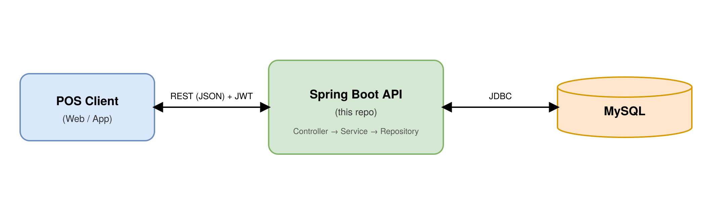
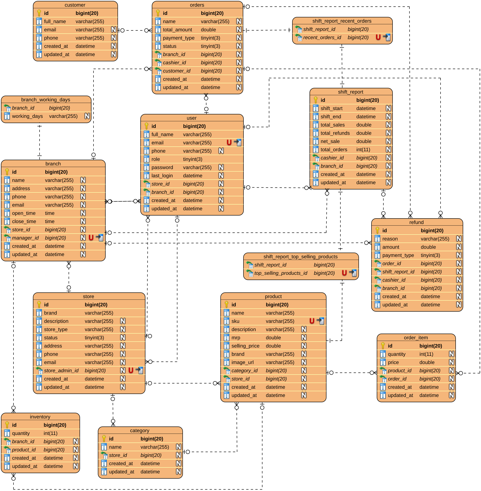

# Omni Nexus POS – Backend

> RESTful backend (Spring Boot) for **Omni Nexus POS** – a multi-store, multi-branch Point of Sale platform: manage stores, branches, staff, products, inventory, customers, orders, refunds and cashier shift reports.


## Table of Contents

- [Key Features](#key-features)
- [System Architecture](#system-architecture)
- [Tech Stack](#tech-stack)
- [Requirements](#requirements)
- [Installation & Running](#installation--running)
- [Database & Schema](#database--schema)
- [API Documentation](#api-documentation)
- [Testing](#testing)
- [License](#license)

## Key Features

- **Authentication & roles:** sign up / log in with email and password, JWT-based stateless sessions, BCrypt password hashing, role-based users (`ROLE_ADMIN`, `ROLE_STORE_ADMIN`, `ROLE_STORE_MANAGER`, `ROLE_BRANCH_MANAGER`, `ROLE_BRANCH_CASHIER`).
- **Store management:** create and update stores with contact details, a status lifecycle (`PENDING` → `ACTIVE` / `BLOCKED`), and one store per store admin.
- **Branch management:** branches per store with address, contact info, working days, opening hours and an assigned manager.
- **Employee management:** create, update, list and remove employees at store level or branch level, filtered by role.
- **Catalog:** categories and products (SKU, brand, MRP, selling price, image) scoped to a store, with product search.
- **Inventory:** stock quantity per product per branch.
- **Customers:** customer records with search by name or email.
- **Orders:** multi-item orders linked to a branch, cashier and (optionally) a customer; payment types `CASH`, `UPI`, `CARD`; today's and recent orders per branch.
- **Refunds:** refunds linked to an order, cashier, branch and the active shift; queryable by cashier, branch, shift and date range.
- **Shift reports:** start / end a cashier shift and get total sales, total refunds, net sales, order count, payment summaries, top-selling products and recent orders.

## System Architecture



The API follows a classic layered design: **controller → service → repository**, with MapStruct mappers converting between JPA entities and DTOs.

## Tech Stack

| Component        | Technology                                              |
|------------------|---------------------------------------------------------|
| Language         | Java 17+                                                |
| Framework        | Spring Boot 4.0.x (Spring MVC)                          |
| Security         | Spring Security, JWT (jjwt 0.13), BCrypt                |
| ORM              | Spring Data JPA / Hibernate                             |
| Database         | MySQL                                                   |
| Validation       | Jakarta Bean Validation                                 |
| Mapping          | MapStruct 1.6, Lombok                                   |
| Build tool       | Maven (Maven Wrapper)                                   |
| Payment SDKs     | Razorpay, Stripe _(declared as dependencies, not yet wired into the services)_ |
| Testing          | JUnit 5, Spring Boot Test, Spring Security Test        |

## Requirements

- JDK 17 or later
- MySQL 8+ (local install or Docker)
- No separate Maven install needed – use the bundled `./mvnw`

## Installation & Running

### 1. Clone the repository

```bash
git clone https://github.com/tranductrung04/omni-nexus-pos.git
cd omni-nexus-pos
```

### 2. Create the database

Create an empty MySQL database. If you don't have MySQL installed, you can start one with Docker:

```bash
docker run -d --name omni-nexus-mysql \
  -e MYSQL_ROOT_PASSWORD=change_me \
  -e MYSQL_DATABASE=omni_nexus_pos \
  -p 3306:3306 mysql:8
```

### 3. Configure the application

```bash
cp src/main/resources/application.properties.example src/main/resources/application.properties
```

Edit `application.properties` and set your database name, username, password and JWT secret (see [Configuration](#configuration)).

### 4. Build

```bash
./mvnw clean package
```

### 5. Run

```bash
./mvnw spring-boot:run
```

The application runs at http://localhost:5000.  
Hibernate creates / updates the tables automatically on startup.

## Database & Schema



## API Documentation

Authentication endpoints (`/auth/**`) are public. Every `/api/**` endpoint requires a valid token:

```
Authorization: Bearer <jwt>
```

Main endpoints:

| Resource       | Method & Endpoint                                                                 | Description                                  |
|----------------|-----------------------------------------------------------------------------------|----------------------------------------------|
| Auth           | `POST /auth/signup`                                                               | Register a user (`ROLE_ADMIN` not allowed)   |
|                | `POST /auth/login`                                                                | Log in and receive a JWT                     |
| Users          | `GET /api/users/profile`                                                          | Current user profile                         |
|                | `GET /api/users/{id}`                                                             | Get user by id                               |
| Stores         | `POST /api/stores`                                                                | Create a store                               |
|                | `GET /api/stores`, `GET /api/stores/{id}`                                         | List stores / get a store                    |
|                | `GET /api/stores/admin`, `GET /api/stores/employee`                               | Store of the current admin / employee        |
|                | `PUT /api/stores/{id}`, `PATCH /api/stores/{id}`, `DELETE /api/stores/{id}`       | Update, patch (e.g. status), delete          |
| Branches       | `POST /api/branches`, `PUT /api/branches/{id}`, `DELETE /api/branches/{id}`       | Create, update, delete                       |
|                | `GET /api/branches/{id}`, `GET /api/branches/store/{storeId}`                     | Get a branch / list branches of a store      |
| Employees      | `POST /api/employees/store/{storeId}`, `POST /api/employees/branch/{branchId}`    | Create store / branch employee               |
|                | `GET /api/employees/store/{storeId}`, `GET /api/employees/branch/{branchId}`      | List employees                               |
|                | `PUT /api/employees/{id}`, `DELETE /api/employees/{id}`                           | Update, delete                               |
| Categories     | `POST /api/categories`, `PUT /api/categories/{id}`, `DELETE /api/categories/{id}` | Create, update, delete                       |
|                | `GET /api/categories/store/{storeId}`                                             | List categories of a store                   |
| Products       | `POST /api/products`, `PUT /api/products/{id}`, `DELETE /api/products/{id}`       | Create, update, delete                       |
|                | `GET /api/products/store/{storeId}`                                               | List products of a store                     |
|                | `GET /api/products/store/{storeId}/search`                                        | Search products                              |
| Inventories    | `POST /api/inventories`, `PUT /api/inventories/{id}`, `DELETE /api/inventories/{id}` | Create, update, delete stock record       |
|                | `GET /api/inventories/{id}`, `GET /api/inventories/branch/{branchId}`             | Get record / list stock of a branch          |
|                | `GET /api/inventories/branch/{branchId}/product/{productId}`                      | Stock of one product in a branch             |
| Customers      | `POST /api/customers`, `PUT /api/customers/{id}`, `DELETE /api/customers/{id}`    | Create, update, delete                       |
|                | `GET /api/customers`, `GET /api/customers/{id}`, `GET /api/customers/search`      | List, get, search                            |
| Orders         | `POST /api/orders`, `DELETE /api/orders/{id}`, `GET /api/orders/{id}`             | Create, delete, get                          |
|                | `GET /api/orders/branch/{branchId}`, `/cashier/{cashierId}`, `/customer/{customerId}` | Orders by branch / cashier / customer    |
|                | `GET /api/orders/today/branch/{branchId}`, `/recent/branch/{branchId}`            | Today's / recent orders of a branch          |
| Refunds        | `POST /api/refunds`, `DELETE /api/refunds/{id}`, `GET /api/refunds/{id}`          | Create, delete, get                          |
|                | `GET /api/refunds`, `/cashier/{cashierId}`, `/branch/{branchId}`, `/shift-report/{shiftReportId}` | List / filter refunds       |
|                | `GET /api/refunds/cashier/{cashierId}/range`                                      | Refunds of a cashier in a date range         |
| Shift reports  | `POST /api/shift-reports/start`, `POST /api/shift-reports/end`                    | Start / end the current cashier's shift      |
|                | `GET /api/shift-reports/current`                                                  | Current open shift                           |
|                | `GET /api/shift-reports`, `GET /api/shift-reports/{id}`                           | List / get shift reports                     |
|                | `GET /api/shift-reports/branch/{branchId}`, `/cashier/{cashierId}`, `/cashier/{cashierId}/by-date` | Filter shift reports      |

## Testing

```bash
# Run all tests
./mvnw test

# Full build with verification
./mvnw verify
```

The current test suite contains a Spring context-load test, so a reachable MySQL database matching your `application.properties` is required.

## License

MIT. See [LICENSE](LICENSE) file.